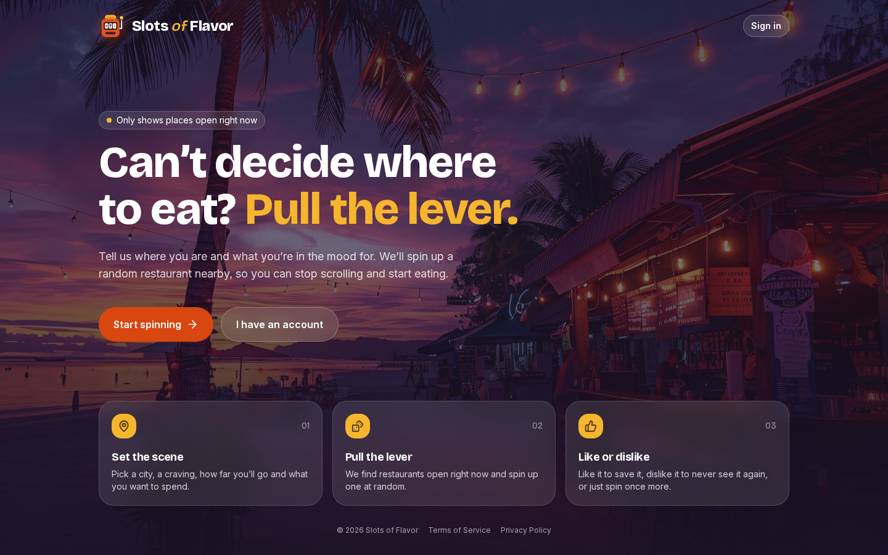

# Slots of Flavor

**Can't decide where to eat? Pull the lever.**

Slots of Flavor picks a random restaurant for you. Tell it where you are, what you're craving, how far you'll go and what you want to spend. It finds places that are open right now, spins a slot-machine reel through them and lands on one. Like it to save it, dislike it to never see it again, or spin once more.

**Live site:** https://slots-of-flavor.vercel.app



## Updates

- **October 2026: back online.** The Yelp API's free tier ended, so restaurant search now uses the Google Places API. The app also got a full redesign built for phones, a slot-machine spin animation, clearer error messages, a daily search limit, and self-serve account deletion.

## Features

- **Slot-machine picks.** The reel spins through real nearby restaurants before landing on your pick. "Spin again" re-rolls from the same results without using another search.
- **Filters.** Location (with city autocomplete), craving, distance (1–25 miles) and price ($–$$$$). Only places open right now are shown.
- **Like or dislike.** Liked places are saved to My spots. Disliked places never come up in your spins again (you can move them back any time).
- **Built for phones.** On mobile the result opens in a full-screen sheet, so the reel is always in view.
- **Daily search limit.** Each user gets 5 searches a day, with a cap of 30 a day across all users, and the app shows how many are left. Both reset at midnight Pacific.
- **Helpful errors.** If a search fails, the app says why (location not found, Google not responding, offline, out of searches) and offers to try again when that would help.
- **Accounts.** Email/password or Google sign-in with Firebase Authentication. Users can delete their account and all saved data from My spots.
- **Terms of Service and Privacy Policy** pages, linked across the site.

## Tech stack

- [Next.js 16](https://nextjs.org/) (App Router) with React 19 and TypeScript
- [Tailwind CSS](https://tailwindcss.com/) and [Lucide](https://lucide.dev/) icons
- [Firebase](https://firebase.google.com/) Authentication and Cloud Firestore
- [Google Places API (New)](https://developers.google.com/maps/documentation/places/web-service/op-overview) and Geocoding API
- Hosted on [Vercel](https://vercel.com/)

## How it works

- **Search:** `app/api/places/route.ts` runs a Google Places Text Search for open restaurants. When a distance is chosen, it geocodes the location and keeps only results within that radius.
- **Security:** the search route only accepts requests with a valid Firebase sign-in token. Place photos are served through `app/api/places/photo/route.ts` with signed URLs, so the Google API key never reaches the browser.
- **Search limit:** Firestore keeps two counters per day: `usage/YYYY-MM-DD` for all searches and `usage/YYYY-MM-DD/users/{uid}` for each user. The server checks both before calling Google. Firestore rules only let a count go up by one (never past 30 total or 5 per user), and the total can only go up in the same write as the caller's own count, so no one can use up other people's searches.
- **Saved places:** stored at `users/{uid}/liked/{placeId}` and `users/{uid}/disliked/{placeId}`.

## Running it locally

1. Clone the repository and install dependencies:

   ```
   git clone https://github.com/ttoy12/Slots-of-Flavor.git
   cd Slots-of-Flavor
   npm install
   ```

2. Create a `.env.local` file with your Google and Firebase settings:

   ```
   GOOGLE_PLACES_API_KEY=
   NEXT_PUBLIC_FIREBASE_API_KEY=
   NEXT_PUBLIC_FIREBASE_AUTH_DOMAIN=
   NEXT_PUBLIC_FIREBASE_PROJECT_ID=
   NEXT_PUBLIC_FIREBASE_STORAGE_BUCKET=
   NEXT_PUBLIC_FIREBASE_MESSAGING_SENDER_ID=
   NEXT_PUBLIC_FIREBASE_APP_ID=
   NEXT_PUBLIC_FIREBASE_MEASUREMENT_ID=
   ```

   `GOOGLE_PLACES_API_KEY` is server-only, so never prefix it with `NEXT_PUBLIC_`.

3. Set up the Google API key:
   - Create a project in [Google Cloud Console](https://console.cloud.google.com/) and attach a billing account (required even for free usage).
   - Enable **Places API (New)** and **Geocoding API**.
   - Create an API key and restrict it to those two APIs.
   - Google includes a free monthly allowance per API. Searches use the Text Search Enterprise tier (because of the rating and price fields), and each photo shown is a Place Photos request. To stay free, set daily quotas (for example 30 Text Search, 30 photo and 50 geocoding requests) and a budget alert.

4. Set up Firebase:
   - Enable **Email/Password** and **Google** sign-in under Authentication.
   - In **Firestore Database → Rules**, paste in the contents of `firestore.rules` and publish.
   - When deploying, add your site's domain under **Authentication → Settings → Authorized domains**.

5. Start the dev server:

   ```
   npm run dev
   ```

   Then open http://localhost:3000.

Other scripts: `npm run build`, `npm run start` and `npm run lint`.

## Tests

- `npm test` runs the unit tests.
- `npm run test:rules` checks `firestore.rules` against the Firestore emulator, including that no one can use up other people's searches. It needs Java 11 or newer and downloads the Firebase CLI on first run.

Run `npm run test:rules` after any change to `firestore.rules`, then publish the rules (paste them into the console, or run `npx firebase-tools deploy --only firestore:rules --project <your-project-id>`).

## Configuration

- **Daily search limits:** `USER_DAILY_SEARCH_LIMIT` (per user) and `DAILY_SEARCH_LIMIT` (all users) in `lib/searchLimit.ts`. Change the matching `5` and `30` in `firestore.rules` too, and keep the total within your Google Cloud quota.
- **Contact email for the legal pages:** `CONTACT_EMAIL` in `lib/legal.ts`.
- **Colors and fonts:** theme tokens in `app/globals.css`.

## Demo

An older demo of the original Yelp-based version is on YouTube: [Slots of Flavor demo](https://www.youtube.com/watch?v=iQstPxtEtl0).
